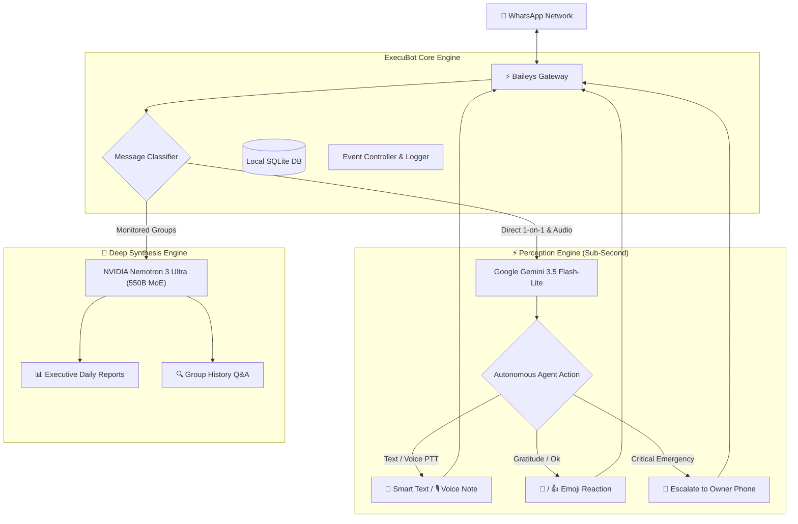

<div align="center">

# ⚡ ExecuBot
### Autonomous Desktop WhatsApp AI Executive Assistant
**Powered by Google Gemini 3.5 Flash-Lite & NVIDIA Nemotron 3 Ultra 550B**

[](https://opensource.org/licenses/MIT)
[](https://nodejs.org/)
[](https://www.electronjs.org/)
[](https://github.com/WhiskeySockets/Baileys)
[](https://aistudio.google.com/)
[](https://build.nvidia.com/)

<br />

```
  ███████╗██╗  ██╗███████╗ ██████╗██╗   ██╗██████╗  ██████╗ ████████╗
  ██╔════╝╚██╗██╔╝██╔════╝██╔════╝██║   ██║██╔══██╗██╔═══██╗╚══██╔══╝
  █████╗   ╚███╔╝ █████╗  ██║     ██║   ██║██████╔╝██║   ██║   ██║   
  ██╔══╝   ██╔██╗ ██╔══╝  ██║     ██║   ██║██╔══██╗██║   ██║   ██║   
  ███████╗██╔╝ ██╗███████╗╚██████╗╚██████╔╝██████╔╝╚██████╔╝   ██║   
  ╚══════╝╚═╝  ╚═╝╚══════╝ ╚═════╝ ╚═════╝ ╚═════╝  ╚═════╝    ╚═╝   
```

*An intelligent, privacy-first Windows 11 Fluent desktop companion that manages direct chats, screens incoming inquiries, transcribes voice notes, summarizes noisy groups, and drafts replies in your authentic voice.*

[English Overview](#-key-features) • [Quickstart Guide](#-quickstart-guide) • [Architecture](#-dual-ai-orchestration) • [الدليل باللغة العربية](#-دليل-الاستخدام-باللغة-العربية)

---

</div>

## 🌟 Key Features

<table>
  <tr>
    <td width="50%">
      <h3>⚡ Sub-Second Perception & 1-on-1 Chats</h3>
      <ul>
        <li><b>Google Gemini 3.5 Flash-Lite Brain</b>: Sub-second conversational responses.</li>
        <li><b>Autonomous Decision Trace</b>: Decides between text, voice notes, reactions, or escalation.</li>
        <li><b>Multimodal Audio Transcriptions</b>: Automatically transcribes voice notes into text.</li>
        <li><b>Natural Reactions (🤲 / 👍 / ❤️)</b>: Reacts to acknowledgments without spamming messages.</li>
      </ul>
    </td>
    <td width="50%">
      <h3>🧠 Deep Group Synthesis & Intelligence</h3>
      <ul>
        <li><b>NVIDIA Nemotron 3 Ultra 550B</b>: Deep reasoning over noisy group discussions.</li>
        <li><b>Executive Daily Reports</b>: One-click structured reports with decisions and action items.</li>
        <li><b>Group Chat Q&A</b>: Ask questions in plain English or Arabic about past group history.</li>
        <li><b>Custom Group Personas</b>: Automated contextual replies for select groups.</li>
      </ul>
    </td>
  </tr>
  <tr>
    <td width="50%">
      <h3>🛡️ Privacy-First & Knowledge Card</h3>
      <ul>
        <li><b>Zero Data Hallucinations</b>: Grounded strictly in your personal Knowledge Card.</li>
        <li><b>Smart Guardrails</b>: Disallows financial promises, contracts, and credential sharing.</li>
        <li><b>Temporary Human Takeover</b>: Automatically pauses for 15 minutes when you type manually.</li>
        <li><b>Emergency Escalations</b>: Instantly alerts your private phone number on urgent inquiries.</li>
      </ul>
    </td>
    <td width="50%">
      <h3>🎨 Windows 11 Fluent Desktop Interface</h3>
      <ul>
        <li><b>Modern Mica/Fluent Styling</b>: Built with native Windows 11 design principles.</li>
        <li><b>Bilingual Localization (i18n)</b>: Full English & Arabic (العربية) UI with RTL support.</li>
        <li><b>First-Time Onboarding Wizard</b>: 3-step setup with zero technical hassle.</li>
        <li><b>ChatGPT / Claude Meta-Prompt</b>: Generate your Knowledge Card via an AI interview.</li>
      </ul>
    </td>
  </tr>
</table>

---

## 🏛️ Dual-AI Orchestration



---

## 🚀 Quickstart Guide

### 1. Prerequisites
* **Node.js**: `v20.x` or later ([Download Node.js](https://nodejs.org/))
* **Git**: Installed on your system
* **Python** *(Optional, for Edge-TTS audio)*: Python 3.10+ with `pip install edge-tts`

### 2. Clone & Install

```bash
# Clone the repository
git clone https://github.com/your-username/ExecuBot.git

# Navigate into the project directory
cd ExecuBot

# Install npm dependencies
npm install
```

### 3. Launch ExecuBot

```bash
npm start
```

### 4. Complete the 3-Step Onboarding Wizard
When launched for the first time, ExecuBot opens the **Setup Wizard**:
1. **Choose Language**: Select **English** (Default) or **العربية**.
2. **Enter API Keys**:
   * **Google Gemini API Key**: [Get your free key from Google AI Studio](https://aistudio.google.com/app/apikey) (Free tier, no credit card required).
   * **NVIDIA NIM API Key**: [Get your free 1,000 credits from NVIDIA NIM](https://build.nvidia.com/).
3. **Configure Your Profile**:
   * Use the **`📋 Copy ChatGPT Interview Prompt`** button to interview yourself in ChatGPT/Claude.
   * Paste the resulting JSON block using **`📥 Import Profile JSON`** to instantly configure your Knowledge Card.
4. **Scan WhatsApp QR Code**: Link WhatsApp using **Linked Devices** on your mobile app.

---

## ⚙️ Model Customization & Configuration

ExecuBot allows you to freely swap or update AI models directly from the desktop UI under **Settings ➔ AI Engine & API Keys**:

| Setting | Default Value | Description |
| :--- | :--- | :--- |
| **Gemini Model ID** | `gemini-2.5-flash-lite` | Used for sub-second perception, screening, and audio STT. Can be set to `gemini-3.5-flash-lite` or any Gemini model. |
| **NVIDIA Model ID** | `nvidia/nemotron-3-ultra-550b-a55b` | Used for group synthesis and daily reporting. Compatible with any model on NVIDIA NIM. |
| **NVIDIA Base URL** | `https://integrate.api.nvidia.com/v1` | OpenAI-compatible endpoint URL. |
| **Default Voice** | `ar-EG-ShakirNeural` | Default voice for PTT voice notes (supports Egyptian & English voices). |

---

## 🔒 Security, Privacy & Local Execution

* **100% Local SQLite Storage**: All WhatsApp messages, contacts, and reports are stored locally in `data/assistant.db`. Nothing is transmitted to external telemetry servers.
* **End-to-End Encryption**: Utilizes Baileys multi-device encryption keys stored locally in `data/auth_session/`.
* **Zero Guessing Guardrail**: The autonomous agent strictly references your approved Knowledge Card. If asked about unknown facts, it replies that it doesn't know or defers to you.
* **Strict Financial Blacklist**: ExecuBot is programmed with hard guardrails preventing it from ever promising financial sums, signing agreements, or sharing credentials.

---

<div dir="rtl">

## 🇸🇦 دليل الاستخدام باللغة العربية

### ما هو ExecuBot؟
**ExecuBot** هو مساعد تنفيذي ذكي لسطح المكتب (Windows 11 Fluent) مخصص لإدارة حسابك على واتساب بذكاء اصطناعي مزدوج فائق التطور:
* **⚡ جيمي (Google Gemini 3.5 Flash-Lite)**: يتولى محادثات الخاص (1-on-1)، يفهم الرسائل النصية والصوتية (STT)، ويرد فوراً بلهجة طبيعية أو بريأكت (`🤲` / `👍`) أو بتسجيل صوتي بشري، ويصعد الطوارئ لرقمك الخاص.
* **🧠 نيمترون (NVIDIA Nemotron 3 Ultra 550B)**: يحلل نقاشات الجروبات المعقدة والمتشعبة ويصيغ لك ملخصاً وتقريراً يومياً تنفيذياً مرتباً بالقرارات والمهام المطلوبة منك.

### طريقة التشغيل السريعة:
```bash
# 1. تنزيل الكود
git clone https://github.com/your-username/ExecuBot.git
cd ExecuBot

# 2. تثبيت الحزم
npm install

# 3. تشغيل البرنامج
npm start
```

### معالج الإعداد لأول مرة:
1. اختر لغة الواجهة (**العربية** أو **الإنجليزية**).
2. ضع مفاتيح الـ API (كلاهما مجاني تماماً وبدون أي تكلفة من Google AI Studio و NVIDIA NIM).
3. اضغط على زر **`📋 نسخ برومبت ChatGPT`** والصقه في شات جي بي تي ليقوم بسؤالك 4 أسئلة عن طبيعة عملك ونبرة كلامك، ثم انسخ الكود الناتج واضغط **`📥 استيراد JSON`** ليتم ضبط بطاقتك الشخصية في ثوانٍ.
4. امسح رمز الـ QR من هاتفك (الأجهزة المرتبطة ⬅️ ربط جهاز).

</div>

---

## 📄 License
This project is licensed under the [MIT License](LICENSE).

---

<div align="center">
  <sub>Built with ❤️ by Yahya & the Open Source Community.</sub>
</div>
